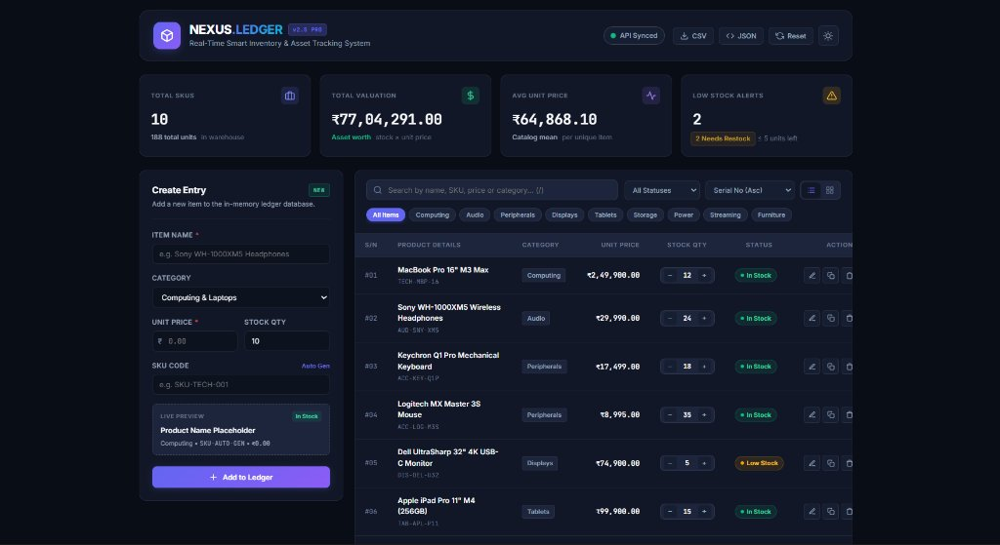
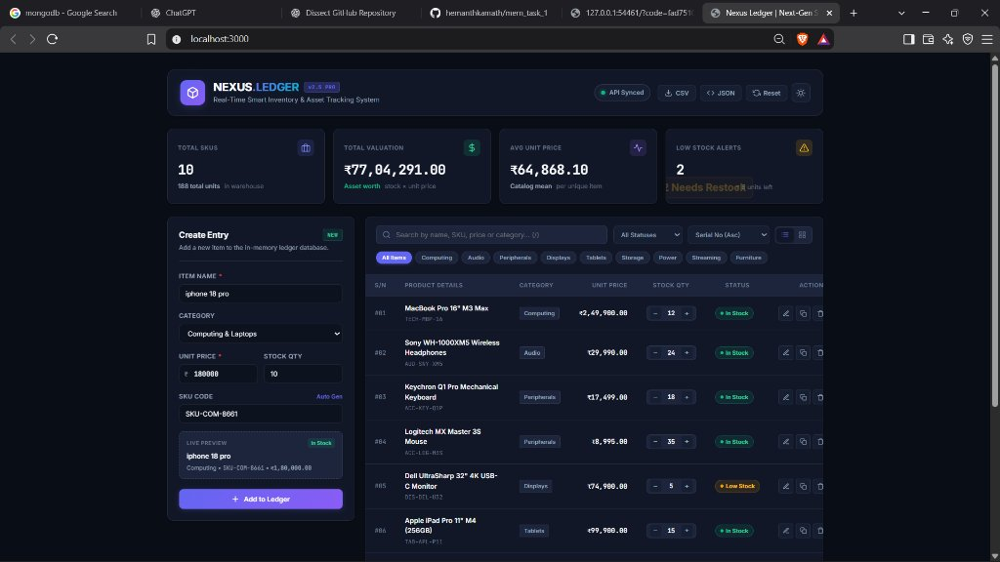
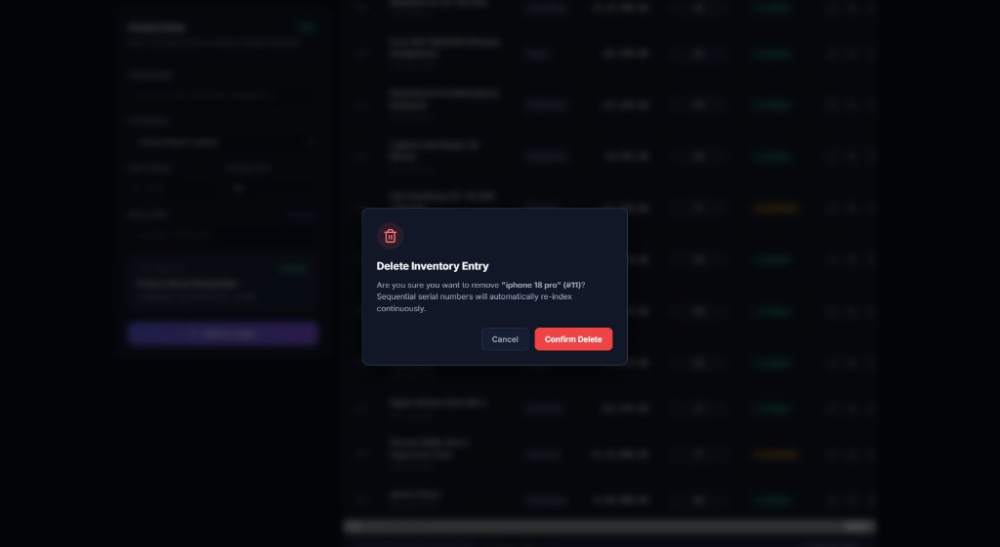
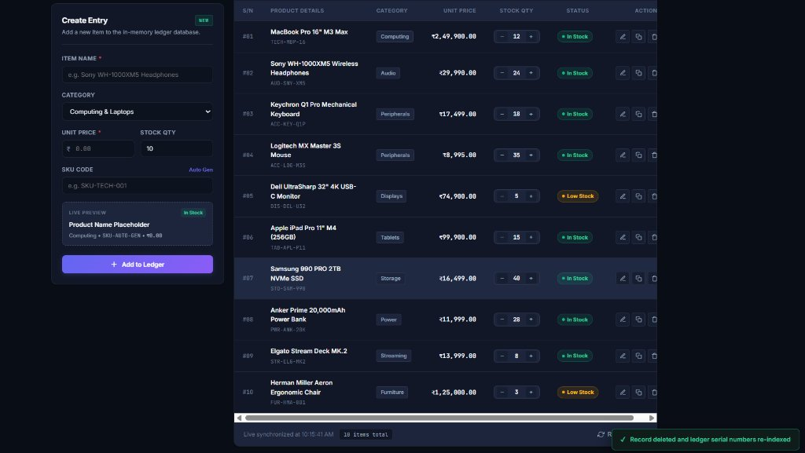

# NEXUS.LEDGER — Real-Time Smart Inventory & Asset Tracking System

NEXUS.LEDGER is a modern, high-performance inventory management and asset tracking platform built with **Node.js**, **Express**, and modern Vanilla JavaScript (ES6+). Engineered with a high-end cyberpunk-slate SaaS design system, the system delivers real-time catalog analytics, continuous sequential serial number auto-reindexing, interactive stock steppers, live creation previews, omni-search filtering, and one-click data export utilities.

---

##  Screenshots & Visual Walkthrough

### 1. Main Dashboard & KPI Analytics Overview


> **Description:** The central command dashboard displaying real-time aggregated inventory intelligence:
> - **Total SKUs:** Live tracking of unique items and total warehouse units.
> - **Total Valuation:** Real-time cumulative asset valuation (calculated dynamically from `stock × unit price`).
> - **Average Unit Price:** Catalog mean valuation per unique item.
> - **Low Stock Alerts:** Interactive alert badge identifying depleted items (≤ 5 units remaining) with click-to-filter capability.
> - **Catalog Ledger:** Tabular view featuring sequential serial indexing (`#01` to `#10`), category tags, interactive stock steppers (`−` / `+`), and status badges (*In Stock*, *Low Stock*).

---

### 2. Dynamic Entry Creation & Real-Time Preview


> **Description:** The interactive **Create Entry** form enabling rapid inventory intake:
> - **Live Preview Card:** Dynamically reflects item name, category, SKU, and unit price in real-time as the user types.
> - **One-Click Auto-SKU Generator:** Generates standardized prefix-based SKU codes automatically (e.g. `SKU-COM-8661`).
> - **Validation & Instant Sync:** Verifies required fields and adds records to the ledger without page reloads.

---

### 3. Continuous Re-indexing & Safety Confirmation Modal


> **Description:** High-visibility safety modal triggered prior to record removal. Confirms user intent and notifies that sequential serial numbers (`#01`, `#02`, etc.) will automatically re-index continuously to maintain an unbroken sequence.

---

### 4. Post-Action Notification & Re-indexed Ledger


> **Description:** Immediate feedback upon record deletion with an animated confirmation toast (*"✓ Record deleted and ledger serial numbers re-indexed"*). Demonstrates that all subsequent records have their sequential IDs recalibrated instantaneously.

---

##  Key Features & Capabilities

- **Continuous Serial Re-indexing:** Deleting any entry automatically triggers server-side ID recalibration, ensuring no gaps or fragmented serial numbers in the ledger.
- **Real-Time KPI Analytics:** Instant automatic computation of Total Valuation, Average Price, Stock Quantities, and Low Stock Alerts.
- **Interactive Stock Steppers:** Direct one-click stock quantity adjustment (`+` / `−`) from the table row without entering full edit mode.
- **Live Omni-Search & Filtering:**
  - Instant search across item names, SKU codes, categories, and price thresholds (press `/` to focus).
  - Horizontal quick-filter chips for all categories (**Computing**, **Audio**, **Peripherals**, **Displays**, **Tablets**, **Storage**, **Power**, **Streaming**, **Furniture**).
  - Stock status selector (**All Statuses**, **In Stock**, **Low Stock**, **Out of Stock**).
  - Multi-attribute sorting by Serial No, Unit Price, Stock Count, or Name.
- **Dual Display Modes:** Switch between a high-density **Tabular Ledger View** and a visual **Product Grid Card View**.
- **Dark & Light Mode Switcher:** Instant theme switching with persistent client-side storage.
- **Data Export & Backup:** One-click instant export of the entire ledger to **CSV (Spreadsheet)** or **JSON (Full Payload)**.
- **Factory Reset Utility:** One-click catalog reset option restoring the default curated device inventory.

---

##  Technology Stack

| Layer | Technology | Details |
| :--- | :--- | :--- |
| **Backend Runtime** | Node.js | Fast, asynchronous JavaScript execution |
| **REST API Server** | Express 5 | RESTful routing, JSON body parsing, and static file serving |
| **Frontend Core** | Vanilla JavaScript (ES6+) | Lightweight, dependency-free reactive DOM updates |
| **Markup & Layout** | HTML5 & Modern CSS3 | Custom CSS properties, CSS Grid, Flexbox, and Glassmorphism |
| **Typography** | Inter & JetBrains Mono | Clean enterprise typography with monospace data formatting |
| **Data Protocol** | RESTful JSON API | Standard HTTP communication with structured status codes |
| **Version Control** | Git & GitHub | Source tracking and version control |

---

## 📡 REST API Reference

| Method | Endpoint | Description | Request Body | Response Status |
| :--- | :--- | :--- | :--- | :--- |
| `GET` | `/items` | Retrieve all inventory items with sequential S/N | None | `200 OK` (Array) |
| `POST` | `/items` | Create and append a new inventory item | `{ "name": string, "price": number, "category"?: string, "stock"?: number, "sku"?: string }` | `201 Created` |
| `PUT` | `/items/:id` | Update an existing item's fields | `{ "name": string, "price": number, "category"?: string, "stock"?: number, "sku"?: string }` | `200 OK` |
| `PATCH` | `/items/:id/stock` | Increment or decrement stock quantity | `{ "delta": number }` | `200 OK` |
| `DELETE` | `/items/:id` | Delete item and trigger continuous serial re-indexing | None | `200 OK` |
| `POST` | `/items/reset` | Reset catalog back to default sample catalog | None | `200 OK` |

---

## 📂 Project Structure

```text
smart-inventory-ledger/
├── public/
│   ├── index.html        # Modern dashboard layout with dark/light themes & KPI cards
│   ├── script.js         # REST client, omni-search, category filters, CSV/JSON export, live preview
│   └── style.css         # Cyber-slate design system, responsive grid, badges & themes
├── screenshots/
│   ├── 01-dashboard-kpi-overview.png      # Main dashboard with live KPI analytics
│   ├── 02-create-item-preview.png         # Item creation form with live preview card
│   ├── 03-delete-confirmation-modal.png   # Safety modal with re-indexing notice
│   └── 04-continuous-reindexing.png       # Success notification & re-indexed ledger
├── server.js             # Express REST API, sequential auto-reindexing & stock controller
├── package.json          # Project metadata and dependencies
├── .gitignore
└── README.md
```

---

## 🚀 Getting Started

### Prerequisites

- [Node.js](https://nodejs.org/) (v16.0 or higher)
- npm (Node Package Manager)
- [Git](https://git-scm.com/)

---

### Quick Start Instructions

1. **Clone the repository:**
   ```bash
   git clone https://github.com/hemanthkamath/mern_task_1.git
   cd mern_task_1
   ```

2. **Install dependencies:**
   ```bash
   npm install
   ```

3. **Start the application server:**
   ```bash
   node server.js
   ```

4. **Launch the web application:**
   Open your browser and navigate to:
   ```text
   http://localhost:3000
   ```

---

## 📄 License

This project is open-source and available under the [MIT License](LICENSE).
